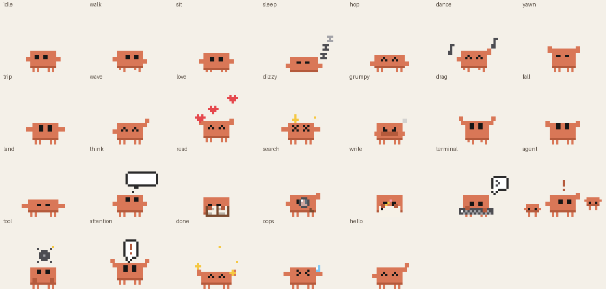

# Claude Virtual Pet

A tiny pixel-art Claude that lives on your Windows desktop. It wanders around, climbs on your open windows, naps, dances, trips over its own feet, and acts out whatever Claude is doing: reading, searching, writing, running commands, spinning up sub-agents, or waving for your attention.



- **Small and light.** A single ~130 KB native Windows program: no installer, no runtime, no framework. It animates only while visible, and while hidden it just checks about once a second whether the Claude desktop app is open.
- **Shows up when Claude does.** It appears whenever the **Claude desktop app** window is open and not minimized, and hides when it's minimized or closed. (If you only use Claude Code in a terminal or claude.ai in a browser, there's no Claude window to watch: turn on *Show even when Claude is minimized* in its right-click menu, or run it with `--always`.)
- **Doesn't touch your stuff.** It never clicks, types into, or changes other windows. It only reads where windows are (so it can stand on them), whether the Claude desktop app window is open, and where your cursor is (so it can look at it).
- **Optional Claude Code plugin** for exact, instant reactions to every tool Claude uses.

## Install

**Windows, 64-bit.** (Tested on Windows 11.)

1. Download [`ClaudePet.exe`](plugin/bin/ClaudePet.exe) from this repo (open it and use the download button), or clone the repo and build it yourself.
2. Put it somewhere permanent (for example `C:\Users\<you>\Apps\ClaudePet\`) and double-click it. It starts in the system tray and appears whenever the Claude desktop app window is open.
3. Right-click the pet (or its tray icon) and turn on **Start with Windows** so it's always around.

> **SmartScreen:** because the exe is small, unsigned and new, Windows may show "Windows protected your PC". Click **More info → Run anyway**, or build it yourself from source (below) if you'd rather not trust a binary.

**Updating:** quit the pet first (right-click → Quit), because Windows won't let you overwrite a running exe, then replace the file and launch it again. If you save the new exe under a different name or folder instead, just launching it takes over from the running pet.

### Optional: Claude Code plugin

If you use [Claude Code](https://claude.com/claude-code), the plugin tells the pet exactly what Claude is doing, instantly.

```
/plugin marketplace add ASDFboy/claude-virtual-pet
/plugin install pixel-pet@pixel-pet
```

Then restart the session. The plugin's hooks run `ClaudePet.exe --hook`, which reads the hook event, hands it to the running pet, and exits. (If the pet isn't running, a new session starts it.) Only the event name and the tool name are used; nothing is stored or sent anywhere.

## What it does

| Claude is... | The pet... |
| --- | --- |
| thinking | shows a thought bubble with dots |
| reading files (`Read`) | sits and reads a book |
| searching (`Grep`, `Glob`, `WebSearch`, `WebFetch`) | sweeps a magnifying glass |
| writing or editing (`Write`, `Edit`, `TodoWrite`) | scribbles on paper with a pencil |
| running commands (`Bash`, `PowerShell`) | types on a keyboard under a `>_` bubble |
| starting a sub-agent (`Task`/`Agent`) | gets two mini-pets hopping around it |
| using any other tool (MCP etc.) | spins a gear over its head |
| waiting on you (permission, notification) | jumps and waves under a red **!** |
| hitting a failed tool | sweats and shakes |
| finished | does a happy hop with sparkles |

On its own it idles, looks at your cursor, walks around, sits, hops, dances when it's happy, yawns and naps when it gets tired, and occasionally trips.

**It climbs your windows.** The tops of open windows are platforms: it jumps up onto them (and from one window to a higher one), walks along them, hops or wanders off the edge, and rides along when you move a window. Minimize, close or cover the window and it falls back down to the taskbar.

**Play with it.** Drag it anywhere (drop it on a window and it lands on top), throw it (it bounces off the screen edges and falls back down), click it for hearts, click it a lot and it gets dizzy, wake it from a nap and it gets grumpy.

**Right-click menu:** show even when Claude is minimized, react to Claude app activity, size (2x to 8x), start with Windows, nap/wake, hide, quit.

## How it knows what Claude is doing

- **Claude Code on this PC** (the plugin above): exact, instant events from Claude Code's hooks.
- **The Claude desktop app and claude.ai chats** don't run hooks on your PC. With *React to Claude app activity* on, the pet watches how busy the Claude app's processes are: a sustained burst of CPU means Claude is replying (thinking bubble), and when it settles the pet celebrates. That's a guess, so it's less precise, and it steps aside automatically whenever real hook events are coming in.

## Command line

```
ClaudePet.exe                  run the pet (replaces a running one)
ClaudePet.exe --always         stay visible even when there's no Claude desktop app window
ClaudePet.exe --event think    play an animation by hand
ClaudePet.exe --quit           close a running pet
ClaudePet.exe --hook           (used by the plugin) read a Claude Code hook event on stdin
```

`--event` accepts any of: `think read search write terminal agent tool attention done oops hello` (Claude activity) and `idle walk sit sleep hop dance yawn trip wave love dizzy grumpy` (its own moods).

Settings are stored under `HKEY_CURRENT_USER\Software\ClaudePet`.

## Building from source

The whole app is one C file plus a header that draws the sprite.

**Windows (MinGW-w64):**

```
gcc -O2 -s -mwindows -o plugin\bin\ClaudePet.exe src\claudepet.c -luser32 -lgdi32 -lshell32 -ladvapi32 -ldwmapi
```

**Linux/macOS (cross-compile with [Zig](https://ziglang.org)):**

```
pip install ziglang
./build.sh
```

A GitHub Actions workflow (`.github/workflows/build.yml`) is included. It builds the exe the same way as `build.sh` on every push, and for `v*` tags it attaches the exe and a SHA-256 checksum to the release.

## Project layout

```
src/claudepet.c     the app: window, physics, behavior, Claude-window detection, tray, hook receiver
src/pet_draw.h      the sprite: every frame is drawn procedurally from rectangles
tools/preview.c     renders frames on Linux for checking the art
plugin/             the Claude Code plugin (hooks + the prebuilt exe)
.claude-plugin/     marketplace manifest so the plugin can be installed from this repo
docs/               preview image
```

Adding an animation is one `case` in `src/pet_draw.h` (plus a name in `ST_NAMES`). `tools/preview.c` lets you look at it without running Windows.

## Troubleshooting

- **I don't see the pet.** It only shows while the Claude desktop app window is open and not minimized. Check the tray for its icon, or right-click it and enable *Show even when Claude is minimized*, or run `ClaudePet.exe --always`.
- **It reacts but with a delay or only "thinking".** Without the plugin it can only guess from CPU use. Install the Claude Code plugin for exact reactions.
- **The plugin does nothing.** Make sure `plugin/bin/ClaudePet.exe` exists in the installed plugin and restart the Claude Code session after installing.

## Credits

Created by **Jeffrey Landgrave** (ASDFboy, [@ASDFboy](https://github.com/ASDFboy)) and **Claude** (Anthropic), who wrote the code and art together.

## License

[MIT](LICENSE)
